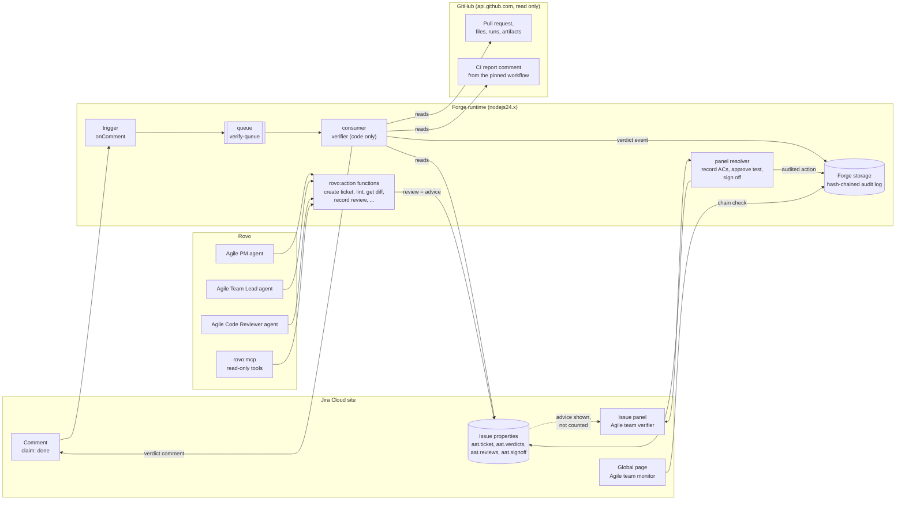

# Architecture

One Forge app on Jira. The verifier is code. The Rovo agents write tickets, give opinions and
review pull requests; their output is shown as advice and never sets a verdict.

## What decides a verdict

- Only `src/verifier/` decides: `checks.js` runs each check, `verdict.js` combines them into
  `supported`, `contradicted` or `cannot_verify`. A check that is marked advisory is shown and not
  counted.
- Inputs: the pull request and its CI report from GitHub; the work item, its acceptance criteria,
  the AC record, approvals and sign-offs from Jira and the audit log.
- A person's action in the panel (record ACs, approve a test change, sign off) writes the audit
  event first. The verifier counts it only when the audit event exists and the person is not the
  claimant.
- A model's review is stored in `aat.reviews` and shown under "Advice from a model, not counted".
  `test/review-advice.test.js` checks that a review never changes a verdict.

## Where to read more

- Claim types and checks: `docs/claims.md`
- CI report format: `docs/ci-report.md`
- Actions that change state: `docs/ACTIONS.md`
- The five demo cases: `docs/JUDGE-PATH.md`
